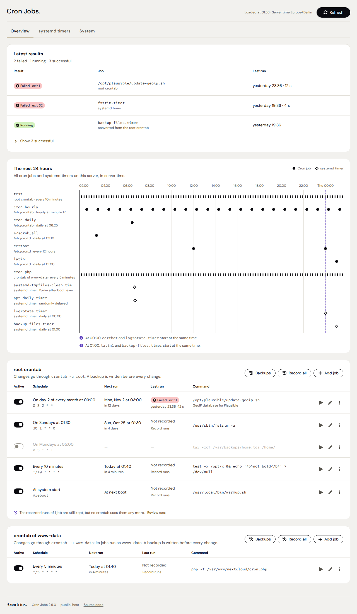
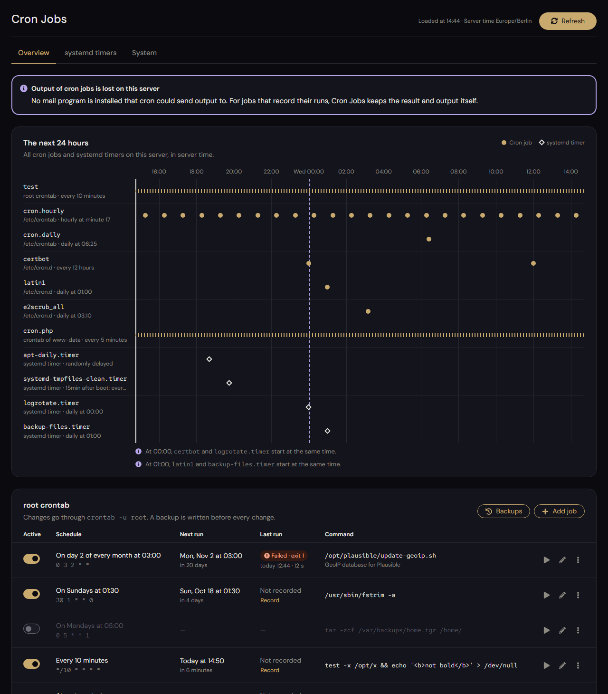
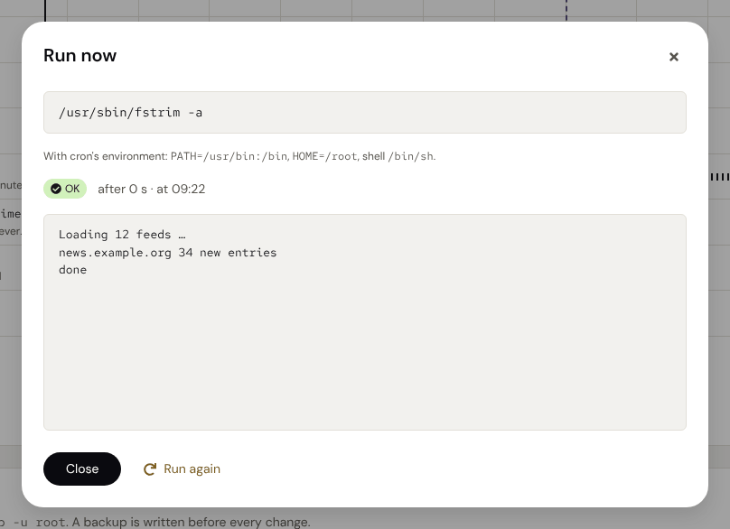
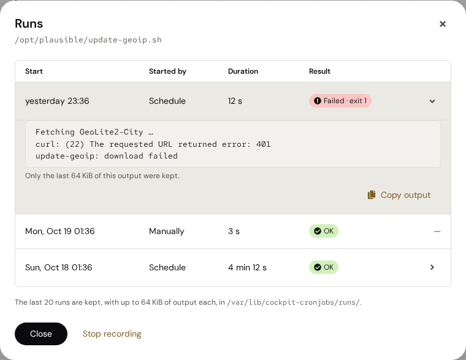
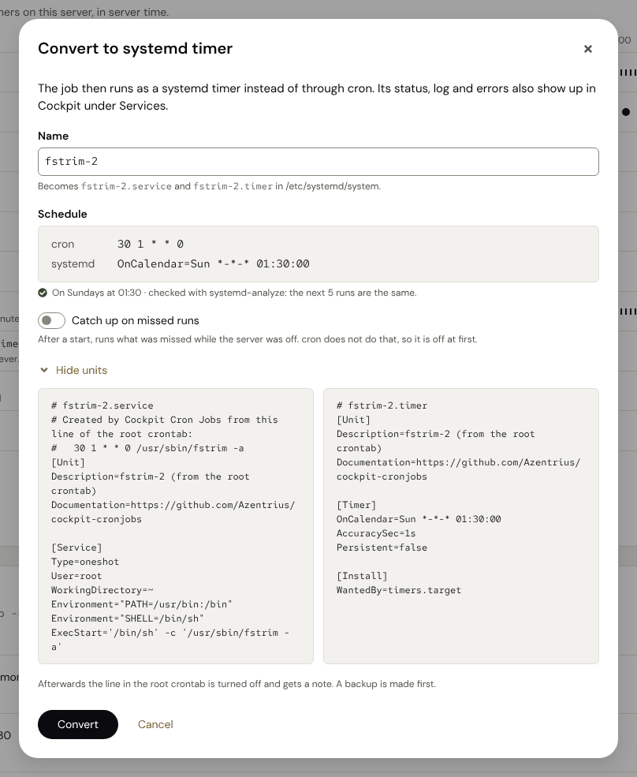
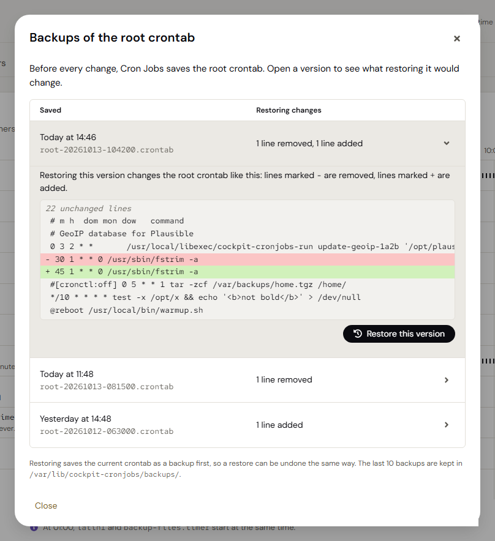

# Cron Jobs

A [Cockpit](https://cockpit-project.org) page for cron. It shows everything that is scheduled on a
server, lets you change the root crontab and those of other users safely, keeps the result of every run,
starts jobs on demand and turns cron jobs into systemd timers.

Every change shows first what it will do, writes the crontab only if it is still the one you see, after
a backup, and leaves the lines you did not touch byte for byte. Jobs that do not record their runs, and
those of `/etc/crontab` and `/etc/cron.d`, get what cron's own log tells about them. A status for the
Azentrius Status Board says, without opening the page, when a job failed or cron is not running.

| Light | Dark |
|---|---|
|  |  |

| Run now | Recorded runs | Convert to systemd timer | Backups |
|---|---|---|---|
|  |  |  |  |

The screenshots show test data in a stand-in for Cockpit; they come from the CI artifact
`docs-screenshots` (`test/docs_shots.py`).

**Contents**

- [What it does](#what-it-does)
- [Architecture](#architecture)
- [Security model](#security-model)
- [Requirements](#requirements)
- [Install, update, uninstall](#install-update-uninstall)
- [Recording runs](#recording-runs)
- [Status for the Status Board](#status-for-the-status-board)
- [Cron's environment](#crons-environment)
- [Files](#files)
- [Operation and troubleshooting](#operation-and-troubleshooting)
- [Translations](#translations)
- [Development](#development)
- [Releasing](#releasing)
- [Known limits](#known-limits)
- [License](#license)

---

## What it does

- **Everything that runs, in one place.** The root crontab, `/etc/crontab`, `/etc/cron.d`, the crontabs of
  other users, the scripts in `/etc/cron.hourly` … `/etc/cron.monthly`, and systemd timers. Schedules are
  written out in words; next runs are shown in server time, and in your own time when that differs.
  Files in `/etc/cron.d` that cron skips (name, owner, permissions, symbolic links, hard links, and with
  cronie under SELinux the context) are marked with the reason, by the rules of the cron that is installed.
- **Three tabs.** Overview (the latest results, the next 24 hours, the root crontab and those of other
  users), systemd timers, and System (`/etc/crontab`, `/etc/cron.d`, the periodic scripts). Notices stay
  visible in every tab; switching tabs loads nothing.
- **The latest results.** The last run of every recorded job and every systemd timer in one list,
  failures first, successful ones folded away. Runs and timers are read again every half minute, so a
  failure shows within a minute without reloading. A recorded job whose scheduled run cron did not
  start (cron stopped, the server down at the time) shows as missed, with the time it was due, once that
  is five minutes past; runs started by hand do not stand in for it. Where cron's log tells how the last
  run of another job ended (see below), that run is listed too, marked as from cron's log.
- **Runs from cron's log.** For a job that does not record its runs, and for the jobs in
  `/etc/crontab`, `/etc/cron.d` and the crontabs the page only shows, the page says when cron last started
  it: cron logs each start as `(USER) CMD (COMMAND)` (Debian's cron with `-L 8` and more puts the job's
  PID before the command), and the page reads those of the last 35 days from the journal, only messages
  root logged as `CRON` or `CROND` (`_UID` 0, which journald sets), and matches them by user and by the
  command as cron logs it. How that run ended is in the log only when cron logs it: Debian's
  cron with `-L 15` logs the end and failures (exit status, signal) as well, and the page shows them
  (failed, OK, running, with the duration); cronie logs the end, never a result. As Debian's cron is set
  up by default, it logs only starts, and the System tab says how to change that.
- **Runs from the journal.** Every systemd timer gets the same runs dialog as a recorded job, from the
  journal of its service: start, duration, result and output. A job converted to a timer keeps its
  history there: the runs recorded before the conversion and those of its service since.
- **The next 24 hours.** A timeline of all cron jobs and timers. Jobs that start in the same minute are
  pointed out.
- **Safe changes to the root crontab.** Add, edit, switch off and on, delete. Lines you do not touch stay
  byte for byte. Each change is written in one locked step, only if the crontab is still the one you see,
  after a backup of the previous version; afterwards it is read back and compared.
- **Crontabs of other users.** With administrative access, every other user's crontab gets a card of its
  own and is changed the same way, through `crontab -u USER`, with backups of its own; its jobs run as
  that user. Without administrative access they are not shown at all. Run now starts their jobs as that
  user, in the user's home with cron's environment, their runs can be recorded, and a conversion gives
  a timer that runs the job as that user (`User=`).
- **Backups you can use.** The last ten versions of the root crontab, each with what restoring it would
  change, line by line as `diff` shows it. Restoring goes through the same locked step, after a backup of
  the current version, so a restore can be undone the same way.
- **The result of every run.** Turn on recording for a job and it keeps exit code, duration and output of
  its last 20 runs. Handy on servers without a mail program, where cron's output is otherwise lost.
  **Record all** on a crontab's card does it for every job there that does not record yet: it lists them
  first, says which cannot (a `%` in the command), and writes the crontab once. A recorded job can also
  be kept from starting while its previous run goes on (see [Recording runs](#recording-runs)).
- **Run now.** Starts a job right away with the environment cron gives it on this server (see below) and
  input after `%`, shows the output live and can stop it.
- **Convert to a systemd timer.** Creates `NAME.service` and `NAME.timer` with the same schedule (checked
  against `systemd-analyze`), the same command and environment, checks what systemd read, starts the
  timer and switches the cron line off with a note. **Back to cron** undoes it in one step: the line is
  on again exactly as before, the note is gone, and the timer is stopped and its units removed. The units
  name the crontab they come from, and back to cron removes only units converted from the crontab whose
  note it follows, so a note a user writes into their own crontab cannot reach anyone else's timer.
- **A status for the Status Board.** Failed jobs of the last 24 hours (recorded ones, those converted
  to systemd timers, and those cron's log says failed), jobs without recording and whether the cron
  service runs, in the status format all
  Azentrius Cockpit add-ons share, readable without administrative access, each with a link to its place
  on the page; the same state as an icon in Cockpit's menu (see below).
- English and German, following Cockpit's language. Light and dark, following Cockpit's style. Usable on
  a phone.

## Architecture

- **The page** (`src/`, installed as `/usr/share/cockpit/cronjobs`) is plain JavaScript without a build
  step, in ES modules under `src/app/`. It runs in the browser and reaches the server only through
  Cockpit's bridge: it reads with `cockpit.spawn` and `cockpit.file`, and everything that needs root
  goes through Cockpit's administrative access. All scripts that run as root are fixed constants in
  `src/app/system.js` (writing a crontab is always `SAVE_SCRIPT`); values reach them as arguments or
  standard input.
- **The run recorder** (`/usr/local/libexec/cockpit-cronjobs-run`, POSIX `sh`) is installed by the page
  when the first job records its runs, and updated from the page when a newer version comes with it. Cron
  starts it in place of the job (see [Recording runs](#recording-runs)).
- **The status helper** (`/usr/lib/cockpit-cronjobs/cronjobs-status`, POSIX `sh`) and its timer come
  with the packages. As root it writes the status for the Status Board every 15 minutes; anyone can read
  it without root (see [Status for the Status Board](#status-for-the-status-board)).
- **The menu icon** (`src/menu-status.js`) is loaded hidden after the login and reads only the status
  files until the page is opened.
- **State** lives in `/var/lib/cockpit-cronjobs`: backups, recorded runs, the status (see
  [Files](#files)).

Cron Jobs runs no daemon of its own and does not go to the network.

## Security model

- Everything that needs root goes through Cockpit's administrative access, like Cockpit's own pages.
- Commands, names and texts are passed to programs as arguments, never pasted into shell code.
- A crontab is replaced only if it is still exactly the version shown (checksum), under a lock, after a
  verified backup. User names are checked in the page and again as root (letters, digits, `.`, `_`,
  `-`, and a user the system knows); other names stay read-only.
- A crontab that could not be written back exactly is opened read-only.
- Restoring a backup writes it byte for byte through the same step, and shows first what it changes.
- Converting to a timer refuses to go on if systemd would run the job at other times than cron, or reads
  the command or its environment differently; if starting the timer fails, the cron line is switched on
  again and the units are removed.
- Back to cron only removes units that Cron Jobs wrote under that name (plain files, with the first line
  and description it gives them), checked again as root right before; if the timer cannot be stopped,
  the crontab is put back.
- The status timer only reads, apart from its own state: it writes its two status files (each through a
  temporary file beside it), and it creates `/var/lib/cockpit-cronjobs` when it is missing and sets that
  directory to mode 711, as the page does. In another user's directory it reads only what has the form
  of runs, as the page does (no links, regular files, under a time limit).
- Runs from cron's log count only when journald says root logged them (`_UID` 0, which it sets itself)
  as `CRON` or `CROND`; a line another user logs as `CRON` is left out. (Not by `_COMM`: journald reads
  it from `/proc` when it takes the message, and the process that logs a start becomes the job's shell
  right after.) A failure counts for the run whose process it names, only while that run goes on
  (until its end or another boot; with `-L 8` only from the process that logged its start), and on the
  page only for the newest run of that job.
- A job set not to overlap is checked and marked under the run recorder's lock, so of two starts at once
  only one runs; the setting lies in the job's directory of runs and is written there as its owner.

## Requirements

- Cockpit (tested with 314, the one of Ubuntu 24.04, and 362 from its backports; older versions are not
  tested, and neither the packages nor the page check the version)
- cron: `cron` on Debian and Ubuntu, or `cronie` (Fedora, RHEL and its rebuilds, Arch, openSUSE)
- coreutils, util-linux (`flock`, `setsid`), `sed`, `grep`, `awk`: present on any normal installation
- systemd, optionally: for the timers, the timeline entries of timers, the conversion and the status for
  the Status Board

With cronie, `CRON_TZ` is taken into account for next runs, the timeline and the conversion, in every
crontab including `/etc/crontab` and `/etc/cron.d`. When the clock changes, next runs and the timeline
follow cron: when summer time ends, the repeated hour runs only the jobs with `*` in the minute or hour
field again; when it starts, jobs at a fixed time of the skipped hour run right after the change.

Changes need administrative access in Cockpit (“Limited access” turned off). Without it the page shows
the system crontabs and timers, and nothing of other users' crontabs.

## Install, update, uninstall

**From the Azentrius package repository** (Debian, Ubuntu, Fedora, RHEL). Set up
[packages.azentrius.com](https://packages.azentrius.com) once:

```sh
# Debian and Ubuntu
curl -fsSLO https://packages.azentrius.com/azentrius-repository.deb
sudo apt install ./azentrius-repository.deb
sudo apt update

# Fedora and RHEL
sudo rpm --import https://packages.azentrius.com/azentrius.asc
sudo dnf install https://packages.azentrius.com/azentrius-repository.rpm
```

RHEL and its derivatives use the same `dnf` set-up; it is tested on Fedora and on Rocky Linux and
AlmaLinux 9 and 10, not on RHEL itself. The repository has no set-up for openSUSE: there, install
the `.rpm` of a release (below).

Then install **Cron Jobs** in Cockpit under **Applications** (with administrative access), or on the
console with `sudo apt install cockpit-cronjobs` or `sudo dnf install cockpit-cronjobs`. The system's
updates keep it current. The repository takes a package only after checking that this repository's
release workflow built it, and signs it.

**From the files of a release** (on openSUSE the only way). Every
[release](https://github.com/Azentrius/cockpit-cronjobs/releases) has the `.deb` and the `.rpm`,
`SHA256SUMS` and a signed build provenance. Download the package and `SHA256SUMS` into one folder,
check both, then install (`X.Y.Z` is the version):

```sh
sha256sum --ignore-missing -c SHA256SUMS                         # complete and unchanged
gh attestation verify <file> --repo Azentrius/cockpit-cronjobs   # built by this repository's release workflow

sudo apt install ./cockpit-cronjobs_X.Y.Z-1_all.deb                              # Debian, Ubuntu
sudo dnf install ./cockpit-cronjobs-X.Y.Z-1.noarch.rpm                           # Fedora, RHEL
sudo zypper install --allow-unsigned-rpm ./cockpit-cronjobs-X.Y.Z-1.noarch.rpm   # openSUSE
```

The `.rpm` of a release carries no package signature (the repository signs its own copy): `zypper`
needs `--allow-unsigned-rpm`, and the two checks above take the place of the signature. The tests
install the `.deb` on Debian 13 and the `.rpm` on Fedora 43 and on the RHEL rebuilds Rocky Linux and
AlmaLinux 9 and 10 (job `install`); installing the packages on Ubuntu, RHEL itself or openSUSE is
untested.

On other systems the archive `cockpit-cronjobs-X.Y.Z.tar.gz` of a release holds the page:
`sudo tar -xzf cockpit-cronjobs-X.Y.Z.tar.gz -C /usr/share/cockpit`. It brings no status for the Status
Board (see below); the packages do.

**From the source.** `git clone` this repository, then `sudo make install`: the page to
`/usr/local/share/cockpit/cronjobs`, the status helper to `/usr/lib/cockpit-cronjobs` and its timer to
`/usr/lib/systemd/system`, turned on.

**From an earlier installation.** A page installed from the archive or the source is not part of the
package, and one in `/usr/local` would hide it. Remove it first, then install the package:
`sudo rm -rf /usr/share/cockpit/cronjobs` (archive) or `sudo make uninstall` in the checkout
(source). Backups, recorded runs and the run recorder stay.

**Cron Jobs** appears in Cockpit's menu; if it does not show yet, log in to Cockpit again.

For development, `make devel-install` links `src` to `~/.local/share/cockpit/cronjobs`.

**Update.** Installed from the repository, Cron Jobs comes with the system's updates (Cockpit ›
Software Updates, or `apt upgrade` / `dnf upgrade`). From the files of a release, install the new
package the same way; from the archive, unpack it over the old directory. When the new version brings a
newer run recorder, the page says so and updates it with one click.

**Uninstall.**

```sh
sudo apt remove cockpit-cronjobs          # or: sudo dnf remove / sudo zypper remove cockpit-cronjobs
sudo rm -rf /usr/share/cockpit/cronjobs   # installed from the archive
sudo make uninstall                       # installed from the source
# only when no job records its runs any more:
sudo rm -f /usr/local/libexec/cockpit-cronjobs-run
sudo rm -rf /var/lib/cockpit-cronjobs
```

Jobs converted to systemd timers stay timers: take them back to cron first, or keep their units.

## Recording runs

When you turn on “Record result and output” for a job, Cron Jobs installs a small shell script,
`/usr/local/libexec/cockpit-cronjobs-run` (once), and changes the job's line from

```
30 2 * * * /usr/local/bin/backup.sh
```

to

```
30 2 * * * /usr/local/libexec/cockpit-cronjobs-run backup-1a2b '/usr/local/bin/backup.sh'
```

The script runs the command with `$SHELL -c`, just as cron does, and passes the output through, so mail
from cron keeps working. It keeps the last 20 runs, each with up to 64 KiB of output, in
`/var/lib/cockpit-cronjobs/runs/backup-1a2b/`. If it cannot record, the command runs anyway.

A job of another user runs as that user, so it cannot write there: its runs go to
`/var/lib/cockpit-cronjobs/users/USER/runs/`, a directory that belongs to the user (mode 700). Cron Jobs
creates it when you turn on recording for the first job of that user; `/var/lib/cockpit-cronjobs` and
`/var/lib/cockpit-cronjobs/users` are then mode 711, so the user can reach it but list nothing.
Because the directory is the user's, Cron Jobs reads the output and removes the runs there as that user,
and lists only what has the form of runs: nothing the user puts there reaches beyond the user's own jobs.

- Commands with an unescaped `%` cannot be recorded (cron passes the text after `%` as input).
- Turning recording off restores the plain line and deletes the recorded runs.
- When a recorded line is changed or removed outside Cron Jobs, its runs are left over. They are listed
  under the root crontab and can be removed there. A job whose ID any crontab still mentions, even in a
  comment, is never offered, and the check is repeated as root right before anything is removed.
- The command keeps its environment and umask. Mail from cron and the `CMD` line in the system log show
  the wrapper call instead of the plain command; adjust filters that match on them.
- Jobs that record their runs need the script. Before you remove Cron Jobs, turn recording off, or leave
  the script in place.

**Not starting while a run goes on.** Cron starts a job on time, even when its previous run is still
going on: a backup that takes longer than its interval then runs twice at once. For a job that records
its runs, “Do not start while a run goes on” in its dialog keeps that from happening: the page puts the
file `no-overlap` into the job's directory of runs (as its owner), and the run recorder (version 3 and
later) then checks every start against the runs of that job that go on. A start that finds one does not
run the command: it is noted in `skipped.jsonl` there (the last 20, shown in the runs dialog) and ends
with exit code 75; only a start by hand (run now) says so on its output. The line in the crontab stays
as it is, so older versions of the page read it as before; without the file the job overlaps as with
cron.

## Status for the Status Board

Cron Jobs reports its state in the format that all Azentrius Cockpit add-ons share (schema 1), for the
Azentrius Status Board, which shows every add-on of every host in one place. `src/manifest.json` names
the helper:

```json
"azentrius": { "status": ["/usr/lib/cockpit-cronjobs/cronjobs-status", "status"] }
```

`cronjobs-status status --lang en|de` prints the status as JSON. It needs no administrative access:
`cockpit-cronjobs-status.timer` works the status out as root every 15 minutes (and two minutes after a
boot; its service starts the helper through `/bin/sh`, so that SELinux lets it read every crontab) and
writes it to `/var/lib/cockpit-cronjobs/status.json` (English) and `status.de.json` (German),
mode 644; `status` only reads the file of the language asked for (German for `de` and its regions,
English for any other language). Without the file it reports `none` and why.

| Item | State | Link |
|---|---|---|
| `failed` | `danger` when a recorded job failed or was aborted in the last 24 hours, or a run of a job converted to a systemd timer failed or lost its end, or cron's log says a run of another job failed, with the number of those jobs, their IDs, the names of the timers and the paths of the jobs of `/etc/crontab` and `/etc/cron.d`; `ok` when none did; `none` when no job records its runs, none was converted and cron logs no failures | `#/overview/results`: the latest results, failures first |
| `unrecorded` | `none` with the number of jobs that do not record their runs, whose results are therefore not known (or, when cron logs failures, only those); `ok` when every job records them | `#/overview/crontab`: the root crontab, the other users' after it |
| `cron` | `ok` when the cron service runs; `danger` when it runs but cronie's log of the last 24 hours shows that PAM refused to start the jobs of a user and none of that user's jobs started since (root by name, other users in number); when it does not run, `danger` if the crontabs of root and the other users have jobs, else `warning`; `none` when there is no cron service to ask | `#/overview/notices`: where the page says that cron is not running, or that PAM refuses its jobs |

The crontabs of root and the other users count: the jobs there are the ones the page can record,
read as the page reads them, and the jobs converted from them, whose runs come from the journal of
their service as on the page. A converted job counts only while both units are the ones the
conversion wrote, checked as back to cron checks them. When Debian's cron logs starts and failures (`-L` with 1 and 4,
read from its command line as the page reads it), its log of the last 24 hours counts as well, read
as on the page: a failure belongs to the job whose start names the same process, and counts when that
job is still in one of those crontabs, `/etc/crontab` or `/etc/cron.d` and does not record its runs
(those count from their records). When cronie runs (`crond`), its log of the last 24 hours also says
whether PAM refused to start the jobs of a user ("FAILED to authorize user with PAM", which cronie logs
as `crond`), read as on the page: a refusal counts until a job of that user starts again. The files
hold numbers, states, job IDs, the names of timers converted from root's crontab and the paths of
`/etc/crontab` and `/etc/cron.d/FILE` for their jobs; no user names, commands or output. Timers
converted from another user's crontab, jobs of the crontabs that failed by cron's log and users other
than root whose jobs PAM refused are only counted, since the name a conversion suggests begins with
the user's and a job without recording has no name but its command. Each item is stale after an hour
without a new status (`stale_after`), that is four runs of the timer missed.

A click on the tile on the Status Board goes to the link of its most important item: the page opens
on that tab and scrolls to the card. Cockpit keeps a page that is loaded and, when the board jumps to
it again, only changes its address, so the page follows every change of it (`locationchanged`). Every
tab has an address of its own (`#/overview`, `#/timers`, `#/system`), and a tab chosen on the page goes
into it.

**In Cockpit's menu** the entry “Cron Jobs” shows the same state with Cockpit's own icon (red: a job
failed, cron is stopped or PAM refuses its jobs; yellow: a warning, or the status is more than an hour
old) and the summary as its tooltip, judged as the Status Board judges it; nothing to do, no icon. For
this Cockpit loads the page hidden right after the login (`preload` in `src/manifest.json`, as for
Cockpit's own Software updates page); until you open it, the page only reads the status file of its
language every five minutes (`src/menu-status.js`) and runs nothing else.

The packages and `make install` turn the timer on, and it stays on through upgrades. To turn it off for
good: `sudo systemctl mask --now cockpit-cronjobs-status.timer`.

## Cron's environment

Run now and a conversion to a systemd timer give a job the environment cron gives it on this server.
Cron builds it in layers, and the page reads each one from the server:

1. What PAM sets for cron's service (`/etc/pam.d/cron`, with cronie `/etc/pam.d/crond`): through
   `pam_env`, the variables of `/etc/environment` and, on Debian and Ubuntu, `LANG` and the like from
   `/etc/default/locale`.
2. With cronie, `LANG`, the `LC_` variables and `LANGUAGE` of its own environment, which systemd gives
   it from `/etc/locale.conf` (the page reads them with `systemctl show-environment`). Debian's cron
   passes on nothing of its own.
3. The crontab's own variables above the job, `MAILTO` included.
4. Cron's own: `SHELL` (`/bin/sh`) and `HOME` unless the crontab sets them, and `LOGNAME`. `PATH` unless
   the crontab sets it: `/usr/bin:/bin` with Debian's cron, none with Ubuntu's, which starts cron with `-P`
   (so `PATH` comes from `/etc/environment`); with cronie `/usr/bin:/bin:/usr/sbin:/sbin` since 1.7.0 and
   `/usr/bin:/bin` before (Rocky Linux 9 has 1.5.7; the page asks `crond -V`). cronie sets `USER` as well.

A converted unit lists these variables with `Environment=` and removes with `UnsetEnvironment=` what
systemd would add and cron does not give, such as `USER` on Debian and Ubuntu. What is in
`/etc/environment` when you convert is copied into the unit. `/etc/security/pam_env.conf` is not read.

Where cron's PAM service has `pam_systemd` in its session stack (Fedora and the RHEL family, through
`password-auth`), cron opens a logind session for every job, and the job gets its variables:
`XDG_SESSION_ID`, `XDG_RUNTIME_DIR`, `DBUS_SESSION_BUS_ADDRESS` and the like. Run now and a timer open
no such session; the page does not make those variables up, and says so in both dialogs.

## Files

| Path | What |
|---|---|
| `/var/lib/cockpit-cronjobs/backups/` | The last 10 versions of the root crontab (directory 700, files 600) |
| `/var/lib/cockpit-cronjobs/backups/users/USER/` | The last 10 versions of the crontab of USER |
| `/var/lib/cockpit-cronjobs/runs/` | Recorded runs of root's jobs |
| `/var/lib/cockpit-cronjobs/users/USER/runs/` | Recorded runs of the jobs of USER (owned by USER) |
| `…/runs/ID/no-overlap`, `skipped.jsonl` | A job that does not start while a run goes on, and the starts it skipped |
| `/usr/local/libexec/cockpit-cronjobs-run` | The run recorder |
| `/usr/lib/cockpit-cronjobs/cronjobs-status` | The status for the Status Board |
| `/usr/lib/systemd/system/cockpit-cronjobs-status.service`, `.timer` | Writes the status every 15 minutes |
| `/var/lib/cockpit-cronjobs/status.json`, `status.de.json` | The status in English and German (mode 644) |
| `/etc/systemd/system/NAME.service`, `NAME.timer` | Jobs converted to systemd timers |
| `/var/lib/cockpit-cronjobs/converting/` | While a conversion is under way: which one wrote the units of a name (directory 700) |
| `/var/lib/cockpit-cronjobs/.crontab.lock` | Lock while the crontab or the units of a conversion are written |

## Operation and troubleshooting

- **Cron Jobs is not in the menu** after installing: log in to Cockpit again; Cockpit reads the pages at
  the login.
- **Nothing can be changed, other users' crontabs are missing:** turn on administrative access in
  Cockpit (“Limited access” off).
- **A crontab opens read-only:** it holds lines that would not survive being written back exactly, or
  text that is not UTF-8. The card says which; fix the crontab on the console, then reload.
- **“The run recorder is missing”** or **“can be updated”:** jobs that record their runs need
  `/usr/local/libexec/cockpit-cronjobs-run`; the notice installs or updates it.
- **“PAM keeps cron from starting jobs”:** cronie's log shows that PAM refused to start the jobs of the
  users named, with PAM's reason, and none of their jobs has started since. `journalctl -t crond` says
  why; a common cause is a line of `/etc/environment` that pam_env cannot read, such as one with
  `export` where Linux-PAM reads the file with libeconf. Once their jobs start again, the notice goes.
- **How a run ended is not shown** for jobs that do not record their runs: Debian's and Ubuntu's cron log
  only the start unless told otherwise, and the System tab says so. To have cron log the end and failures
  as well, start it with `-L 15`. On Ubuntu, `sudo systemctl edit cron.service` and add

  ```ini
  [Service]
  Environment="EXTRA_OPTS=-L 15"
  ```

  with the quotes (without them systemd sets only `-L`, and cron does not start). On Debian set
  `EXTRA_OPTS="-L 15"` in `/etc/default/cron`. Then `sudo systemctl restart cron`; jobs that run go on.
  cronie logs the end of each job but never how it ended.
- **The Status Board shows the status as old or missing:** the timer writes it every 15 minutes.
  `systemctl status cockpit-cronjobs-status.timer` and `journalctl -u cockpit-cronjobs-status.service`
  say why it did not; `sudo systemctl start cockpit-cronjobs-status.service` writes it at once.
- **Leftover runs** of lines changed or removed outside the page are listed under the root crontab and
  can be removed there.
- **A converted job** keeps its history in the journal of its service; “Back to cron” in its menu
  undoes the conversion.

## Translations

Texts live in `src/i18n/`. To add a language, copy `en.js` to `<code>.js`, translate it, register it under
its code at the end of the file and add a `<script>` line to `src/index.html`. The page picks it when
Cockpit uses that language. `node test/i18n.test.js` checks that every text exists with the same shape.

## Development

```sh
make check        # unit tests: crontab logic, systemd conversion (against systemd-analyze), run recorder, removal of leftover runs, the list of runs, cron's log, back to cron and backups (dash, bash), differences (against GNU diff), texts, the status (dash, bash; mawk, gawk), the menu icon
make check-ui     # browser tests against a stand-in for Cockpit (needs Python Playwright with Chromium)
make docs-shots   # the screenshots of this README into docs/ (CI keeps them as the artifact docs-screenshots)
```

`test/e2e_cockpit.py` runs the main flows against a real Cockpit with real cron. It replaces root's
crontab, so only use it on a throwaway machine or container (see the top of the file). CI runs it on
every push and pull request, on the runner's throwaway VM, twice: with the Cockpit of Ubuntu 24.04 and
cron as installed, and with the Cockpit of its backports and cron at `-L 15` (check `e2e`). It also
runs with cronie and the `.rpm` in Rocky Linux 9 and 10 VMs with SELinux enforcing (job `e2e-el`,
`tools/vm.sh`, not yet a required check): the test as root in the machine, the browser on the runner,
and the job fails on any SELinux denial during the test.

How to set up, test and send a change is in [CONTRIBUTING.md](CONTRIBUTING.md); what comes next is in
[ROADMAP.md](ROADMAP.md).

## Releasing

1. Set the new version in `src/app.js` (`const VERSION`) and add a section for it to `CHANGELOG.md`.
2. Merge to `main`.
3. On GitHub: Actions › **release** › Run workflow (branch `main`). The workflow checks that the version
   is new and matches `src/app.js`, runs the unit and browser tests (`make check`, `make check-ui`; the
   lint, the package installs and the end-to-end test run only in the `test` workflow, on every push and
   pull request), builds `cockpit-cronjobs-VERSION.tar.gz`
   (`make package`) and the `.deb` and `.rpm` (`make packages`), all reproducible, with `SHA256SUMS`,
   and creates the tag `vVERSION` with a release whose notes come from `CHANGELOG.md`. It also signs a
   build provenance for each file; `gh attestation verify <file> --repo Azentrius/cockpit-cronjobs`
   shows that it was built by this workflow from this repository (the archive since 2.1.1, the
   packages since 2.6.0).
4. packages.azentrius.com takes the packages from the release within an hour
   ([Azentrius/packages](https://github.com/Azentrius/packages)). The `.deb` there is the release's byte
   for byte; the `.rpm` gets the repository's own signature, so only its signature header differs.

## Known limits

- `/etc/crontab` and `/etc/cron.d` belong to packages and configuration management: the page shows their
  jobs and what cron's log tells about their runs, but does not change, record, run or convert them.
- A command with an unescaped `%` cannot record its runs (cron passes the text after it as input).
- How a run of a job without recording ended is known only where cron logs it: Debian's cron with `-L`
  (1, 2 and 4, see above). cronie logs the end but never the result. Without `-L 8`, when runs of one
  command overlap, an end that names no run leaves open which one ended: the page then shows only when
  the newest started, until its own end or failure comes or all of them ended;
  without ends and PIDs (`-L 5`) a failure after the PID was used again in the same boot cannot be told
  apart from one of the run that had it before.
- Missed runs are found for jobs that record their runs, and only on the page, not in the status.
- The status names failed jobs of the crontabs that do not record their runs, and timers converted from
  another user's crontab, only in number: their only names are a command or begin with the user's.
- On the RHEL rebuilds, which the end-to-end test covers in Rocky Linux 9 and 10 with SELinux
  enforcing, the page does not know everything yet:
  - With SELinux enforcing, cronie skips a file of `/etc/cron.d` whose context its job may not enter,
    such as a link to a file elsewhere in `/etc` (`etc_t`), and logs "Unauthorized SELinux context".
    The page marks a file whose type (for a link, that of its target) is not the type of `/etc/cron.d`
    itself, but it does not ask the policy: a file of another type the policy lets cron's jobs enter is
    marked as skipped, and when `/etc/cron.d` itself is labelled wrongly, the page does not see it.
  - cronie opens a logind session for every job (`pam_systemd` in `password-auth`), so its jobs have
    `XDG_SESSION_ID`, `XDG_RUNTIME_DIR`, `DBUS_SESSION_BUS_ADDRESS` and the like; run now and a
    converted job do not, as the page says in both dialogs (see [Cron's environment](#crons-environment)).
  - Where Linux-PAM reads `/etc/environment` with libeconf (Rocky Linux 10), `export` is not allowed,
    single quotes stay and the space before a `#` goes; a line pam_env cannot read makes PAM refuse
    every cron job (crond logs "FAILED to authorize user with PAM"). The page and the status warn when
    cronie's log shows PAM refusing jobs, until a job of that user starts again.
- BusyBox cron (Alpine) is not supported. The packages are tested on Debian 13, Fedora 43, Rocky
  Linux and AlmaLinux 9 and 10; installing them on Ubuntu, RHEL itself or openSUSE is untested.
- English and German only (see [Translations](#translations)).

## License

Cron Jobs is licensed under the [Apache License 2.0](LICENSE); see also [NOTICE](NOTICE). Versions up to
and including 2.1.1 were released under the GNU Lesser General Public License, version 2.1 or later.
The page contains no code from Cockpit; it uses Cockpit's API `cockpit.js` at runtime, which Cockpit
itself ships.

The fonts DM Sans, DM Serif Display and Red Hat Mono are licensed under the SIL Open Font License 1.1
([src/OFL.txt](src/OFL.txt)); the icons are Font Awesome Free 5.15.4 by Fonticons, Inc., taken over through
`@patternfly/react-icons` 6.4.0 and licensed under CC BY 4.0
([src/CC-BY-4.0-Font-Awesome.txt](src/CC-BY-4.0-Font-Awesome.txt)).

Made by [Azentrius](https://azentrius.com).
